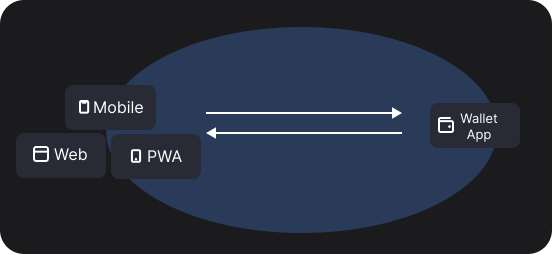

# Mobile Wallet Adapter

**Mobile Wallet Adapter (MWA)** is a generic protocol specification that enables dApps to connect with mobile wallet apps for Solana transaction and message signing.

## Features

### Unified Wallet Integration

Integrate the SDK once and your dApp is compatible with all MWA-compliant wallets.

### Simple User Onboarding

Users connect and choose a familiar wallet with no additional sign-up steps required.

### User Wallet Choice

Give users the freedom to connect with their preferred mobile wallet app.

## Client SDKs

### Mobile

#### Overview

#### React Native

#### Kotlin

### Web

#### Overview

#### Installation

#### Demo
